tanglegram
==========
Generated enhanced dendrograms and tanglegrams.
Inspired by the amazing [dendextend](https://github.com/talgalili/dendextend)
by Tal Galili.

## Features
- dendrograms with additional features compared to scipy: cluster colouring,
  leaf annotation tracks, collapsed clades, radial layouts
- tanglegrams of two or more dendrograms, with shared cluster colours
- measures of how similar two trees are, independent of how they are drawn
- `matplotlib` or `plotly` as plotting backend

## Installation
First, get [PIP](https://pip.pypa.io/en/stable/installing/) and then run in terminal:

```
pip3 install tanglegram -U
```

To install the bleeding-edge version from Github you can run:

```
pip3 install git+https://github.com/schlegelp/tanglegram@master
```

#### Dependencies
Installing via [PIP](https://pip.pypa.io/en/stable/installing/) should install all external dependencies. You may run into problems on Windows though. In that case, you need to install dependencies manually, here is a list of dependencies (check out `dependencies` in [pyproject.toml](https://raw.githubusercontent.com/schlegelp/tanglegram/master/pyproject.toml) for version info):

- [Pandas](http://pandas.pydata.org/)
- [SciPy](http://www.scipy.org)
- [Numpy](http://www.scipy.org)
- [Matplotlib](http://www.matplotlib.org)
- [networkx](https://networkx.org/)

## How it works

`tanglegram` exposes these functions:

1. `tanglegram.dendrogram` plots a simple dendrogam
2. `tanglegram.tanglegram` plots a side-by-side tanglegram for two dendrogams
3. `tanglegram.tanglegram_many` plots a tanglegram for two or more dendrogams as rows
4. `tanglegram.entanglement` measures the entanglement between two linkages
5. `tanglegram.crossings` counts how many pairs of edges cross
6. `tanglegram.untangle` rotates dendrograms to minimize entanglement or crossings
7. `tanglegram.alignment_quality` judges an alignment against what the trees allow
8. `tanglegram.cophenetic_correlation` and `tanglegram.baker_gamma` measure how similar two trees are
9. `tanglegram.cluster_color_map` builds one colour mapping shared across plots

```Python
import tanglegram as tg
import matplotlib.pyplot as plt
import pandas as pd

# Generate two distance matrices and just switch labels in one
labelsA= ['A', 'B', 'C', 'D']
labelsB= ['B', 'A', 'C', 'D']
data = [[ 0,  .1,  .4, .3],
        [.1,   0,  .5, .6],
        [.4,  .5,   0, .2],
        [.3,  .6,  .2,  0]]

mat1 = pd.DataFrame(data,
                    columns=labelsA,
                    index=labelsA)

mat2 = pd.DataFrame(data,
                    columns=labelsB,
                    index=labelsB)

# Plot tanglegram
fig, dn1, dn2 = tg.tanglegram(mat1, mat2, sort=False)
plt.show()
```

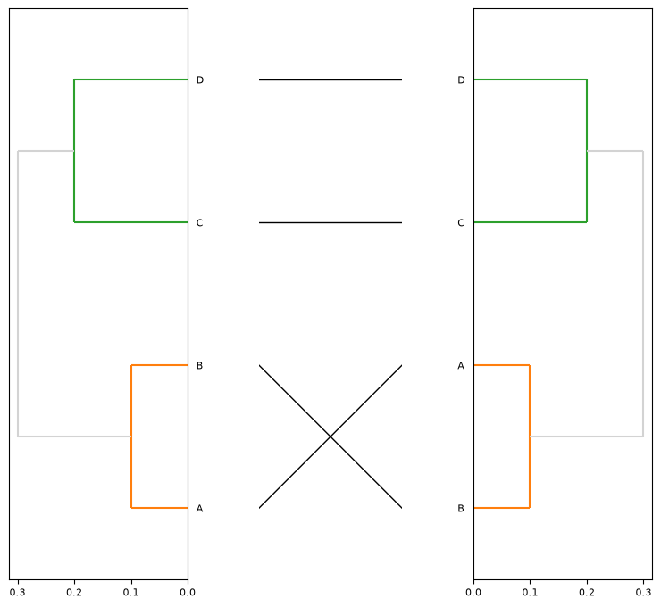

```Python
# Plot again but this time try minimizing cross-over
fig, dn1, dn2 = tg.tanglegram(mat1, mat2, sort=True)
plt.show()
```

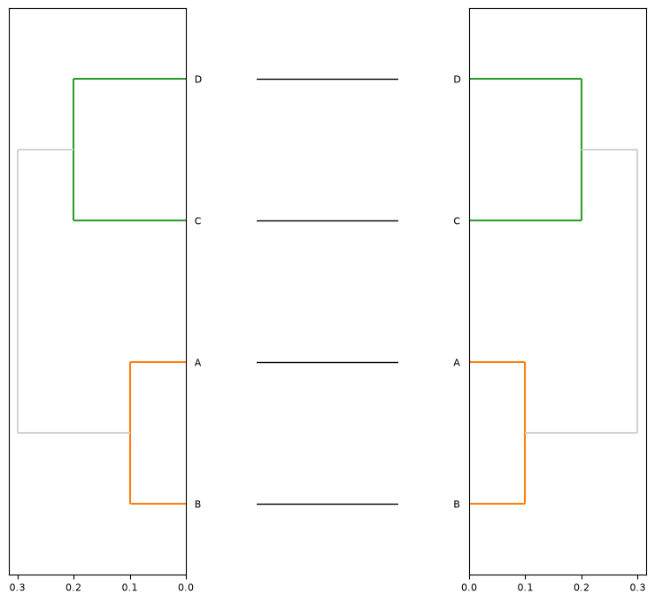

```Python
# Alternatively, you can also explicitly provide the edges to plot and untangle
# Note how in this case the labels don't have to match anymore
fig, dn1, dn2 = tg.tanglegram(mat1, mat2, sort=True, edges=[('A', 'A'), ('C', 'D')])
plt.show()
```

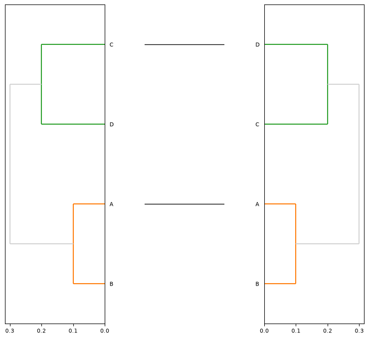

### Dendrograms

`tanglegram.dendrogram` takes the same keyword arguments as scipy's own
`dendrogram` and passes them straight through, so you can treat it as a drop-in
replacement. It returns `(dn, ax)` - the dendrogram dictionary scipy would have
given you, plus the axis (or, with `backend="plotly"`, the figure).

All the examples below share this setup - four groups of six samples with
enough overlap that clustering does not recover the groups perfectly:

```Python
import matplotlib.pyplot as plt
import numpy as np
import scipy.cluster.hierarchy as sch
import tanglegram as tg

rng = np.random.default_rng(4)
centers = np.array([[0, 0], [3, 0.5], [1.5, 3], [4.5, 3.5]], dtype=float)
groups = np.repeat(np.arange(4), 6)
X = centers[groups] + rng.normal(0, 0.9, (24, 2))

Z = sch.linkage(X, method="ward")
group_names = np.array(["A", "B", "C", "D"])[groups]
```

#### Colouring by cluster

scipy can only colour a dendrogram by cutting it at a single height
(`color_threshold`). `clusters` instead takes one label per observation, so the
colouring can come from anywhere - known sample categories, a non-uniform cut,
or any other assignment:

```Python
fig, axes = plt.subplots(1, 2, figsize=(11, 3.6), sharey=True)

sch.dendrogram(Z, color_threshold=0.7 * Z[:, 2].max(), ax=axes[0])
tg.dendrogram(Z, clusters=group_names, ax=axes[1])
```

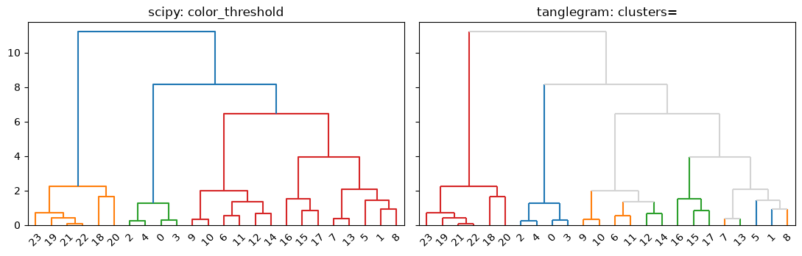

On the left, scipy's threshold produces contiguous blocks by construction. On
the right the colours follow the *known* group of each sample, which the tree
only partly recovers - so several groups show up in more than one place, and
the links that span more than one group are drawn in `above_threshold_color`.

Each branch is coloured by the group it leads to, which is why the stem above a
group is coloured too. This also means a group of a single leaf still gets its
own colour, which is not something `color_threshold` can express.

Note that `clusters` is indexed like your observations, *not* in leaf order,
and that colours are handed out in order of each cluster's first appearance -
so they stay stable between runs.

#### Highlighting part of a tree

Leafs whose cluster is `None` or `NaN` are left unassigned, which makes it easy
to pull out just the clades you care about. `above_threshold_ls` styles
everything else out of the way:

```Python
cut = sch.fcluster(Z, 4, criterion="maxclust")
highlight = np.where(np.isin(cut, [1, 3]), cut, None)

dn, ax = tg.dendrogram(
    Z,
    clusters=highlight,
    cluster_colors={1: "#d62728", 3: "#1f77b4"},
    above_threshold_color="lightgrey",
    above_threshold_ls="--",
)
```

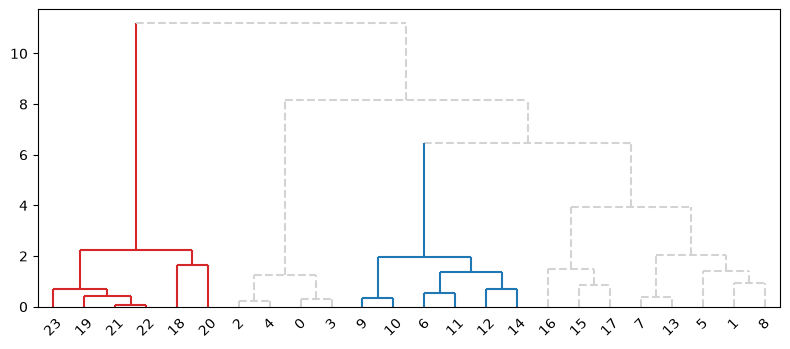

#### Hanging dendrograms and leaf markers

`hanging` shortens the leaf links so they hang off their parent instead of
reaching all the way down to the baseline, and `leaf_marker` marks the tips.
Marker colours default to each leaf's own branch colour:

```Python
fig, axes = plt.subplots(2, 1, figsize=(9, 6), sharex=True)

tg.dendrogram(Z, clusters=group_names, hanging=True, leaf_marker="o", ax=axes[0])
tg.dendrogram(Z, clusters=group_names, hanging=0.02, leaf_marker="o", ax=axes[1])
```

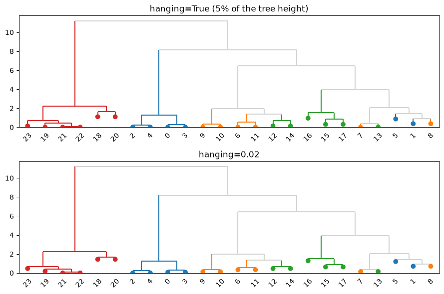

`hanging=True` drops each leaf by 5% of the tree height. Pass a fraction to
tune it: smaller values hug the parent more closely, larger ones drop the leafs
further until they hit the baseline. Leafs never fall below zero.

#### Labelling the links

```Python
small = sch.linkage(X[:8], method="ward")
dn, ax = tg.dendrogram(small, label_dist=True, dist_fmt="{:.2f}")
```

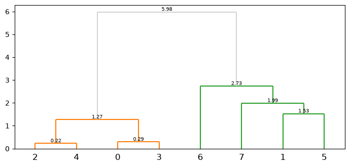

#### Annotating the leafs

`leaf_annot` draws one or more metadata tracks as a colour strip beside the
leafs, like `row_colors` in seaborn's clustermap. Pass a DataFrame (one column
per track), a `{name: values}` dict, or a flat sequence for a single track:

```Python
import pandas as pd

metadata = pd.DataFrame({
    "group": group_names,
    "batch": np.tile(["b1", "b2", "b3"], 8),
    "qc":    np.where(rng.random(24) > 0.25, "pass", "fail"),
})

dn, ax = tg.dendrogram(
    Z,
    clusters=group_names,
    leaf_annot=metadata,
    annot_colors={"pass": "#4caf50", "fail": "#e53935"},
)
```

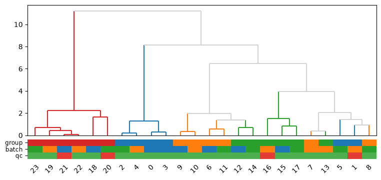

Values are per observation. Anything that already looks like a colour is used
as-is; everything else is treated as a category and coloured for you.
`annot_colors` only has to cover the values you care about - here it fixes the
two `qc` values and leaves `group` and `batch` to colour themselves. The leaf
labels move onto the strip so the two do not fight over the same space, and
`annot_legend=True` adds a legend.

#### Large trees: collapsing clades

Past a few hundred leafs a dendrogram stops being readable. `collapse` draws
whole clades as a single wedge instead:

```Python
big = sch.linkage(rng.random((150, 4)), method="ward")
big_clusters = sch.fcluster(big, 6, criterion="maxclust")

tg.dendrogram(big, clusters=big_clusters, no_labels=True)
tg.dendrogram(big, clusters=big_clusters, collapse="clusters", collapse_width=3)
```

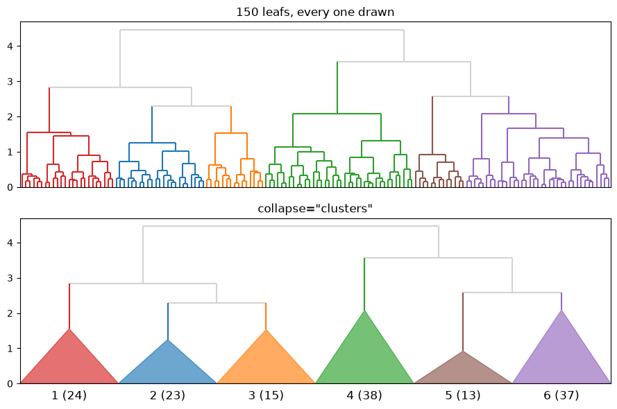

`collapse` accepts three things:

| value | collapses |
|---|---|
| `"clusters"` | each cluster that forms a clade of its own (needs `clusters`) |
| a number | every clade no taller than that height |
| a callable | every clade for which `f(observations)` is true, e.g. `lambda lv: len(lv) <= 10` |

Only the topmost matching clade on each path is collapsed, so a predicate
should describe a clade that is *small or uniform enough* to fold away. The
returned dict gains a `"collapsed"` entry mapping each wedge to the
observations behind it:

```Python
dn, ax = tg.dendrogram(big, collapse=lambda leaves: len(leaves) <= 10)
{node: len(members) for node, members in dn["collapsed"].items()}
```

Note that with `collapse` the dict's `"leaves"` and `"ivl"` describe what is
drawn rather than every leaf, so per-observation arguments (`leaf_annot`, a
per-leaf `leaf_color`, `hover_info`) no longer have anything to attach to and
are rejected.

#### Radial dendrograms

`polar=True` wraps the tree around a circle, leafs on the rim and the root at
the centre. If you pass your own `ax` it has to use a polar projection:

```Python
fig = plt.figure(figsize=(5.5, 5.5))
dn, ax = tg.dendrogram(Z, clusters=group_names, polar=True,
                       leaf_marker="o", leaf_size=20)
```

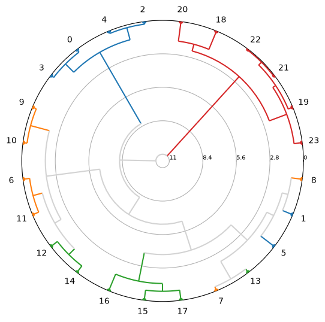

#### plotly backend

`backend="plotly"` renders the same tree as an interactive figure, and
`hover_info` attaches a note to each leaf:

```Python
dn, fig = tg.dendrogram(
    Z,
    clusters=group_names,
    hover_info=[f"sample {i}" for i in range(len(X))],
    leaf_marker="o",
    hanging=0.02,
    backend="plotly",
)
fig.show()
```

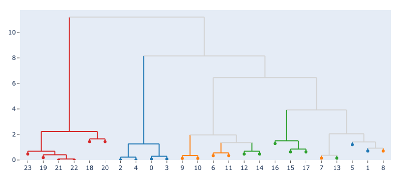

To draw onto a specific subplot of an existing figure, pass a dict:

```Python
from plotly.subplots import make_subplots

fig = make_subplots(rows=1, cols=2)
tg.dendrogram(Z, backend="plotly", fig={"fig": fig, "row": 1, "col": 2})
```

#### Reference

| argument | what it does |
|---|---|
| `clusters` | Cluster assignment per observation. Unlike `color_threshold` it need not follow a single cut, and a cluster of one leaf is coloured too. `None`/`NaN` means unassigned. |
| `cluster_colors` | A `{cluster: color}` mapping, or a sequence cycled in order of first appearance. Defaults to matplotlib's colour cycle. |
| `above_threshold_color` / `above_threshold_ls` | Colour and line style for links that span more than one cluster. |
| `label_dist` / `dist_fmt` | Label every link with its distance. |
| `leaf_marker` / `leaf_color` / `leaf_size` | Mark the leafs; colours default to each leaf's own branch colour. |
| `hanging` | Shorten the leaf links so they hang off their parent. `True` drops them by 5% of the tree height, or pass a fraction. |
| `leaf_annot` / `annot_colors` / `annot_size` / `annot_legend` | Metadata tracks drawn as a colour strip beside the leafs. `matplotlib` only. |
| `collapse` / `collapse_width` / `collapse_label` | Draw whole clades as a wedge to make a large tree readable. |
| `polar` | Draw the tree radially. `matplotlib` only. |
| `backend` / `hover_info` / `fig` | `"matplotlib"` (default) or `"plotly"`; per-leaf hover text and the target figure for the latter. |

`clusters` cannot be combined with scipy's `truncate_mode` (truncation collapses
leafs, so the assignments no longer line up with what is drawn), and `no_plot`
and `link_color_func` are managed internally.

The images above are generated by [docs/make_readme_images.py](docs/make_readme_images.py).

### Colouring a tanglegram

`clusters_left`/`clusters_right` colour the two dendrograms, and both sides
draw from **one** palette - so a cluster that turns up in both is the same
colour in both, which is the whole point when you are comparing them.
`color_edges_by` then carries that colouring onto the connecting edges:

```Python
import scipy.spatial.distance as ssd

# The same 24 samples, clustered twice with a little noise between the two
labels = [f"s{i}" for i in range(24)]
dist_a = pd.DataFrame(ssd.squareform(ssd.pdist(X)), index=labels, columns=labels)
dist_b = pd.DataFrame(
    ssd.squareform(ssd.pdist(X + rng.normal(0, 0.6, X.shape))),
    index=labels, columns=labels,
)

fig, dn1, dn2 = tg.tanglegram(
    dist_a, dist_b,
    sort=True,
    clusters_left=group_names,
    clusters_right=group_names,
    color_edges_by="left",     # or "right"
)
```

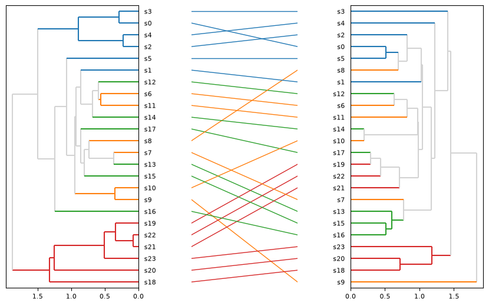

Colouring the edges by cluster turns "did this group stay together?" into
something you can read off the picture. Pass `cluster_colors` to pin the
colours yourself. `tanglegram_many` takes the same treatment via `clusters=`,
which expects one assignment per dendrogram.

If you need the same colours somewhere else, `cluster_color_map` builds the
shared mapping on its own:

```Python
colors = tg.cluster_color_map(group_names, group_names)
```

### Interactive tanglegrams

Both `dendrogram` and `tanglegram` take `backend="plotly"`:

```Python
fig, dn1, dn2 = tg.tanglegram(dist_a, dist_b, sort=True, backend="plotly")
fig.show()
```

Hovering an edge tells you which pair of labels it connects, which is the
easiest way to read a tanglegram whose labels are too small to print.

### Comparing trees without drawing them

`entanglement` and `crossings` score a *drawing* - rotate a dendrogram and they
change. To ask how similar the two hierarchies actually are, use:

```Python
Z_ward = sch.linkage(X, method="ward")
Z_single = sch.linkage(X, method="single")

tg.cophenetic_correlation(Z_ward, Z_single)
tg.baker_gamma(Z_ward, Z_single)
```

Both compare how far apart each pair of leafs sits in one tree against the
other, so rotating a tree leaves them untouched. They return 1 for identical
hierarchies and 0 for unrelated ones.

| function | based on | use it when |
|---|---|---|
| `cophenetic_correlation` | the merge heights themselves | the two linkages are on the same scale |
| `baker_gamma` | the *rank* of those heights | the linkages use different methods or scales |

Baker's gamma ignores any monotonic rescaling of the merge heights, which makes
it the fairer of the two when comparing, say, a `ward` tree against a `single`
one. `cophenetic_distances(link)` returns the underlying leaf-by-leaf matrix if
you want to do something else with it.

Labels are optional - without them the observations are matched by index - and
`edges` lets you spell out the pairing explicitly.

### Untangling methods

`sort=True` uses `dp2side`, but you can name the method explicitly:

```Python
fig = tg.tanglegram(mat1, mat2, sort="dp2side")

# Two-sided untangling can settle in a local optimum - `restarts` re-runs it
# from randomly rotated copies and keeps the best result
fig = tg.tanglegram(mat1, mat2, sort="dp2side",
                    sort_kwargs=dict(restarts=20, seed=0))
```

| method | objective | memory | notes |
|---|---|---|---|
| `dp2side` | displacement | `O(n^2)` | **Default.** Alternates exact `dp1side` solves. |
| `dp1side` | displacement | `O(n^2)` | Rotates the first dendrogram only. |
| `cross2side` | crossings | `O(n)` | Alternates exact `cross1side` solves. Use on large trees. |
| `cross1side` | crossings | `O(n)` | Rotates the first dendrogram only. |
| `random` | displacement | `O(n)` | Legacy. Shuffles `R` times, keeps the best. |
| `step1side` | displacement | `O(n)` | Legacy greedy hinge-by-hinge sweep. |
| `step2side` | displacement | `O(n)` | Legacy greedy sweep on both trees. |

All four `dp*`/`cross*` methods solve their **one-sided problem exactly** -
they find the provably best of all `2**(n-1)` rotations rather than searching
greedily. Two structural facts make this possible: every subtree occupies a
*contiguous* block of leaf slots, and a rotation only decides the order of a
node's two child blocks.

- **Displacement** (`entanglement()`, `sum(abs(pos1 - pos2)**L)`) is a sum of
  independent per-leaf terms, so a dynamic program over `(node, start slot)`
  solves it in `O(n^2)`.
- **Crossings** (`crossings()`) are what a reader actually sees. The crossings
  between a node's two child blocks depend only on *which child comes first*,
  not on where the block sits - so there is no start-slot dimension at all and
  the memory drops to `O(n)`. At `n = 8000` that is 5 MB versus 710 MB.

The two objectives produce near-identical layouts in practice, so use
`cross2side` when `n` is large enough that an `n x n` table hurts, and
`dp2side` otherwise. Both beat the legacy greedy methods on speed (25x at
`n = 1600`, and the gap widens) while never producing a worse result.

### Is my tanglegram as good as it can get?

Entanglement has no natural scale, so a value of 0.43 could mean either a
failed untangling or two trees that genuinely disagree. `alignment_quality`
tells you which:

```Python
link1, link2 = tg.untangle(link1, link2, labels, labels, edges, restarts=20)
print(tg.alignment_quality(link1, link2, labels, labels, edges))
```

```
Alignment quality (800 leafs, 800 edges)
  entanglement           0.4301   (random layout: 0.5763 +/- 0.0443, z = -3.3)
  crossings             128,279
  better than random       25%
  displacement       median 172, max 735 slots; 17% of edges within 40
  verdict            at the structural floor - the trees themselves disagree
```

It compares your alignment against a uniformly random layout (how much did
untangling buy?) and against a fresh optimisation (is anything left on the
table?). When the verdict is `at the structural floor`, no amount of extra
rotation will help - the dendrograms simply have incompatible topologies.

## Known Issues:
- layout does not scale well, i.e. small dendrograms look weird

## License:
This code is under GNU GPL V3
